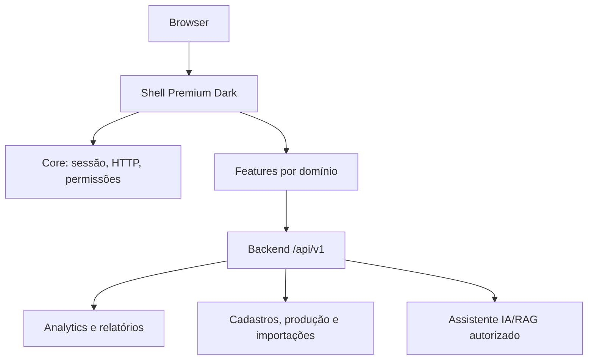

# Arquitetura do Frontend

O frontend é standalone Angular e consome exclusivamente o Backend V1.

Camadas previstas: `core` para sessão, HTTP, DTOs e erros; `shared` para UI; `layout` para sidebar/topbar; `features` para dashboard, produção, cadastros, importações, qualidade, relatórios, auditoria e IA. Dados financeiros, auditoria e RAG dependem da autorização retornada pelo backend.

Não há alteração de banco, migration ou regra do Backend V1. Paginação e filtros permanecem server-side.
